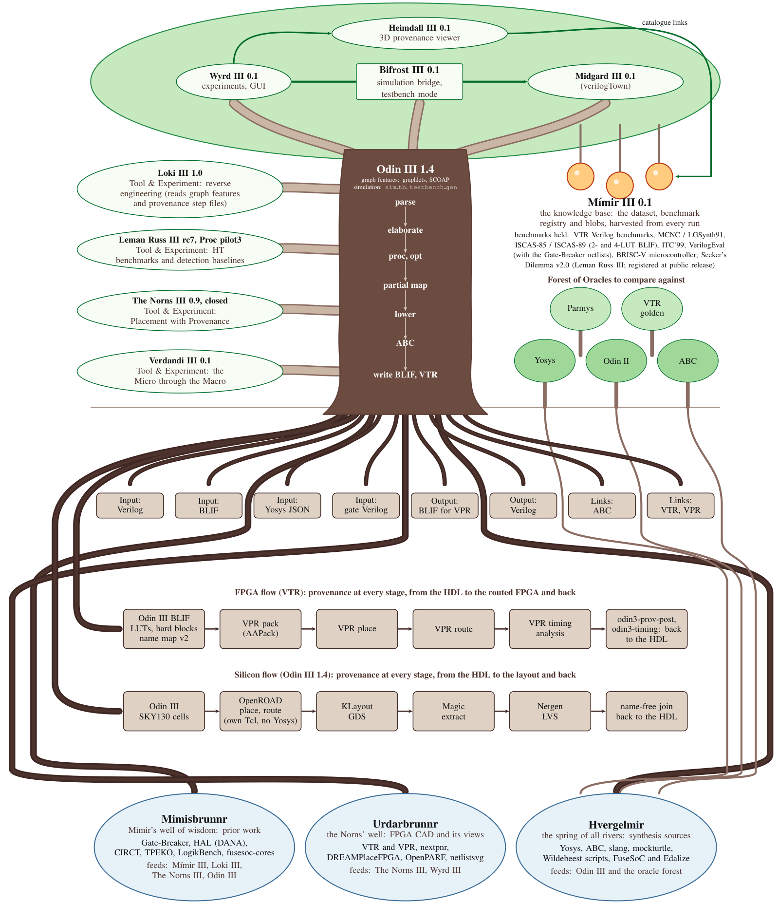

# Yggdrasil III

Yggdrasil III is a suite of CAD and EDA tools for academic FPGA and ASIC-like research. It takes a design
from HDL to a netlist and keeps, for every object in the netlist, a pointer back to the HDL text it came
from. This repository is the starting point: the overall documentation, and the six code repositories
as submodules.

What the pieces do today, in one line each. Odin III (the trunk) is a C17 elaboration and front-end synthesis framework with a
provenance-tracked IR, graph features, a netlist editing API and simulation. Wyrd III runs experiments and carries the
visualization, simulation (Bifrost III) and game (Midgard III) tools. Loki III recovers structure from netlists in four levels
and measures how far that goes without a language model. Leman Russ III builds hardware Trojan benchmarks and detector
baselines. The Norns III tested whether provenance improves packing and placement and is closed with negative results.
Verdandi III replays a design through Odin III step by step. Mímir III holds the circuit dataset and benchmark registry.
Papers are in each repository's `docs/paper`: [Odin III](https://github.com/drpaj12/odin3/tree/main/docs/paper),
[Loki III](https://github.com/drpaj12/loki/tree/main/docs/paper) and
[The Norns III](https://github.com/drpaj12/nornsIII/tree/main/docs/paper); Wyrd III, Verdandi III and Mímir III have none.
The [features page](https://drpaj12.github.io/YggdrasilIII/features.html) lists what each piece can do.



## The layers

| Layer | Piece | What it is | Repository | Documentation |
|---|---|---|---|---|
| Roots | inputs, outputs, linked tools | Reads Verilog, BLIF, Yosys JSON and gate Verilog; writes BLIF for VPR and Verilog; links ABC, VTR and VPR. |
| Deep roots | three wells | The outside work the suite draws on. Mimisbrunnr (Mimir's well of wisdom): prior work (Gate-Breaker, HAL and DANA, CIRCT, TPEKO, LogikBench, fusesoc-cores), feeding Mímir III, Loki III, The Norns III and Odin III. Urdarbrunnr (the Norns' well): FPGA CAD and its views (VTR and VPR, nextpnr, DREAMPlaceFPGA, OpenPARF, netlistsvg), feeding The Norns III and Wyrd III. Hvergelmir (the spring of all rivers): synthesis sources (Yosys, ABC, slang, mockturtle, the Wildebeest ABC scripts, FuseSoC and Edalize), feeding Odin III; the oracle trees drink from it too. | | |
| Oracle forest | the oracles | Yosys, Parmys, Odin II, VTR golden results and ABC. Forest of Oracles to compare against; not part of the suite. | | |
| Trunk | Odin III | The condensed flow: Verilog to a provenance-tracked IR to BLIF for VPR; also graph features (graphlets, SCOAP) used by Loki III and Mímir III, and simulation (`sim_tb`, `testbench_gen`). Version 1.4 (in review) adds a silicon flow (Verilog to a routed SKY130 layout and back, no Yosys) and provenance step files at every stage, which Loki III reads. | [odin3](https://github.com/drpaj12/odin3) | [manual](https://drpaj12.github.io/odin3/) |
| Canopy | Wyrd III | Experiment runner and GUI. | [wyrd](https://github.com/drpaj12/wyrd) | [manual](https://drpaj12.github.io/wyrd/), tutorials: [command line](https://drpaj12.github.io/wyrd/wyrd-tutorial.pdf), [GUI](https://drpaj12.github.io/wyrd/wyrd-gui-tutorial.pdf) |
| Canopy | Bifrost III | The simulation bridge, inside Wyrd III, with testbench mode. | [wyrd](https://github.com/drpaj12/wyrd) | [simulation](https://drpaj12.github.io/wyrd/simulation.html) |
| Canopy | Midgard III | verilogTown, inside Wyrd III. | [wyrd](https://github.com/drpaj12/wyrd) | [Midgard III](https://drpaj12.github.io/wyrd/midgard.html) |
| Canopy | Heimdall III | The 3D provenance viewer (formerly o3viz in Wyrd III): one benchmark as a stack of planes from the HDL to the placed chip, every object linked to its HDL line; builds a static site of benchmarks linked from the Mímir III catalogue. | [heimdallIII](https://github.com/drpaj12/heimdallIII) | [manual](https://github.com/drpaj12/heimdallIII/blob/main/docs/user/viz.md) |
| Side branch | Loki III | Tool & Experiment: reverse engineering of structural netlists in four levels (L0 provenance answer key, L1 Bayesian hypotheses, L2 graph analysis, L3 design-pattern blocks), with a Gate-Breaker LLM harness. | [loki](https://github.com/drpaj12/loki) | [manual](https://drpaj12.github.io/loki/) |
| Side branch | Leman Russ III | Tool & Experiment: hardware Trojan library, insertion and the Seeker's Dilemma v2.0 benchmark families (Seeker-Comb, Seeker-Seq, a Seeker-Proc pilot), with detection baselines. | | |
| Side branch | The Norns III | Tool & Experiment: Placement with Provenance; closed with negative results, the known-optimum yardstick and instruments kept. | [nornsIII](https://github.com/drpaj12/nornsIII) | [plan and paper](https://github.com/drpaj12/nornsIII/tree/main/docs) |
| Side branch | Verdandi III | Tool & Experiment: the Micro through the Macro; an interactive record-and-replay walk of a micro design through Odin III. | [verdandiIII](https://github.com/drpaj12/verdandiIII) | [spec and plan](https://github.com/drpaj12/verdandiIII/tree/main/docs) |
| Fruit | Mímir III | Knowledge base: the circuit dataset harvested from every run and the benchmark registry with its content-addressed blobs (VTR Verilog benchmarks, MCNC / LGSynth91, ISCAS-85 / ISCAS-89 in 2- and 4-LUT BLIF, ITC'99, VerilogEval with the Gate-Breaker netlists, the BRISC-V microcontroller, and the Seeker's Dilemma v2.0 circuits of Leman Russ III once released), to be mined (design meta and lineage, structure and Rent statistics, provenance relationships, QoR per placer family). | [mimirIII](https://github.com/drpaj12/mimirIII) | [spec and draft questions](https://github.com/drpaj12/mimirIII/tree/main/docs), [hub page](https://drpaj12.github.io/YggdrasilIII/pieces/mimir.html); data: <https://drpeterjamieson.com/RESEARCH/MIMIR/mimir-data> |

The [hub documentation](https://drpaj12.github.io/YggdrasilIII/) (sources in `docs/`) covers how the pieces connect:
[getting started](https://drpaj12.github.io/YggdrasilIII/getting-started.html), [working with an AI coding agent](https://drpaj12.github.io/YggdrasilIII/ai-agent.html), [running the suite with Claude Code](https://drpaj12.github.io/YggdrasilIII/agent-controller.html) (templates in [`agent-kit/`](agent-kit/README.md)),
[architecture](https://drpaj12.github.io/YggdrasilIII/architecture.html),
[the pieces](https://drpaj12.github.io/YggdrasilIII/pieces/index.html) and [publications](https://drpaj12.github.io/YggdrasilIII/publications.html).

## Features

What each piece can do today, with its status, is on the [features page](https://drpaj12.github.io/YggdrasilIII/features.html) (source `docs/features.md`); the full tables are in each repository's README.

## Versions

Each hub snapshot pins one commit of every component. Odin III is at 1.4.0, Loki III at 1.0.0 and The Norns III at 0.9.0 (closed); Wyrd III, Verdandi III
and Mímir III are at 0.1.0. The last hub snapshot is v1.4.0. The table of snapshots (v1.1.0, v1.1.1, v1.2.0, v1.4.0)
with the component versions, pins and what each added is in
[versions](https://drpaj12.github.io/YggdrasilIII/versions.html) (source `docs/versions.md`).

| Hub snapshot | Odin III | Wyrd III | Loki III | Verdandi III | The Norns III | Mímir III |
|---|---|---|---|---|---|---|
| v1.1.0 | 1.1.0 | 0.1.0 | 0.1.0 | 0.1.0 | `c49d316` | not a component |
| v1.1.1 | 1.1.1 | 0.1.0 | 0.1.0 | 0.1.0 | `0698983` | not a component |
| v1.2.0 (Odin III 1.2.0) | 1.2.0 | 0.1.0 | 0.1.0 | 0.1.0 | `61fd41b` | 0.1.0 (`b8b4118`) |

## Quick start

New here? Start with the [PDF tutorial](https://drpaj12.github.io/wyrd/wyrd-tutorial.pdf): it makes a project, takes it
through VTR, simulates it, and uses the ready-made samples. The [GUI tutorial](https://drpaj12.github.io/wyrd/wyrd-gui-tutorial.pdf) does the same
in the graphical interface, with a figure for each step.
To set everything up on Windows and drive it with an AI coding agent, see
[working with an AI coding agent](https://drpaj12.github.io/YggdrasilIII/ai-agent.html) and
[running the suite with Claude Code](https://drpaj12.github.io/YggdrasilIII/agent-controller.html).

```bash
git clone --recurse-submodules https://github.com/drpaj12/YggdrasilIII.git && cd YggdrasilIII
(cd components/odin3 && cmake --preset release && cmake --build --preset release)   # Odin III
python3 -m venv .venv && .venv/bin/pip install -e "components/wyrd[gui,sim,midgard]"   # Wyrd III
.venv/bin/pip install --no-deps -e components/loki                                     # Loki III
```

The full clean-machine procedure, for Ubuntu 24.04 and Windows 11, is in
[getting started](https://drpaj12.github.io/YggdrasilIII/getting-started.html).

The `sim` and `midgard` extras need the `odin3` package; see [getting started](https://drpaj12.github.io/YggdrasilIII/getting-started.html)
and each piece's own manual for the details, including VTR and `wyrd config init`.

## Components

`components/` holds odin3, wyrd, heimdall (heimdallIII), loki, verdandi (verdandiIII), norns (nornsIII) and mimir (mimirIII) as git submodules, pinned to a tested commit. To move the pins to
the current `main` of each:

```bash
git submodule update --remote
git add components && git commit -m "components: update pins"
```

## Build the documentation

```bash
python3 -m venv .venv && .venv/bin/pip install -r requirements-docs.txt
.venv/bin/sphinx-build -W -b html docs build/docs
```

The tree picture is regenerated from `images/src/` with `make -C images`.

## How to cite

Cite the Odin III paper: *Odin III, the Final Frontier: Verilog Synthesis, again, Now Leading to
Yggdrasil III built by the dark factory* (no venue yet). Further publications are listed in
[docs/publications.md](https://drpaj12.github.io/YggdrasilIII/publications.html).

## License

MIT. See [LICENSE](LICENSE).
