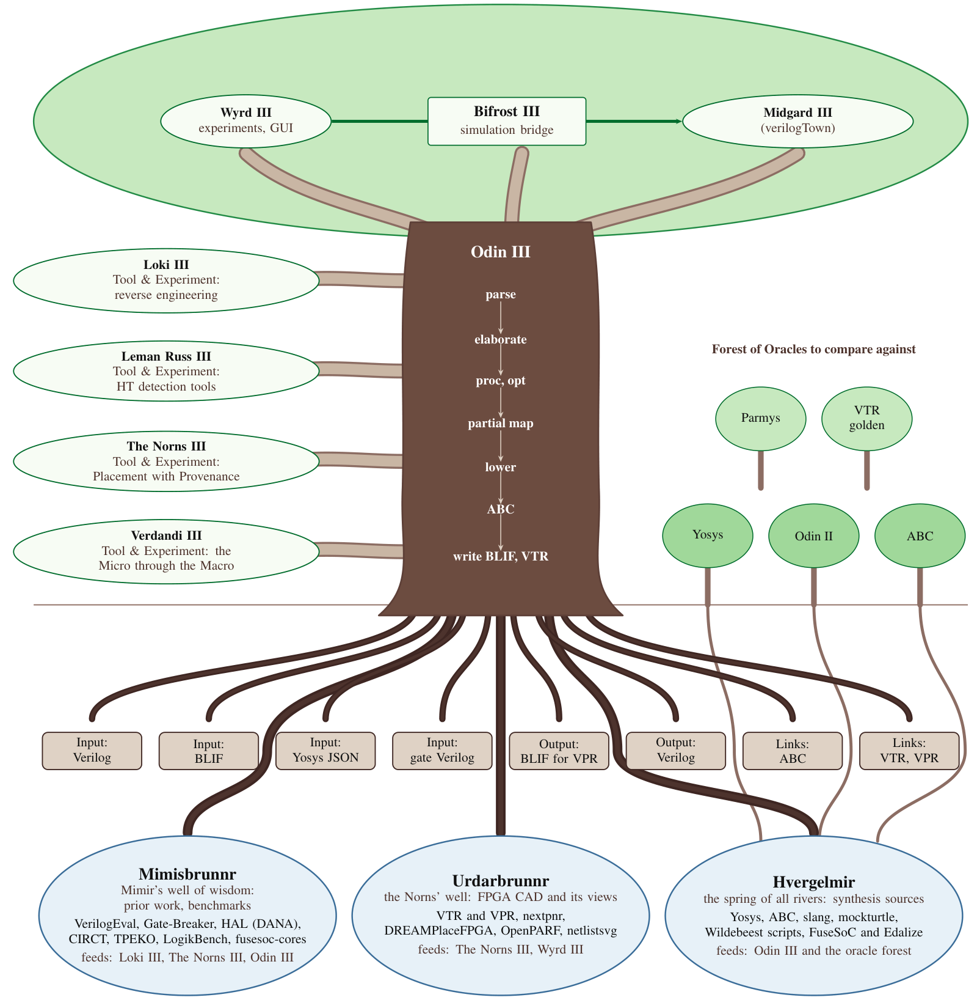

# Yggdrasil III

Yggdrasil III is a suite of CAD and EDA tools for academic FPGA and ASIC-like research. It takes a
design from HDL to a netlist and keeps, for every object in the netlist, a pointer back to the HDL
text it came from. This site is the starting point: it shows how the pieces fit together. Each
piece has its own manual, linked from the page of that piece.



The picture is a tree. The roots are what Odin III reads and writes (Verilog, BLIF, Yosys JSON and gate
Verilog in; BLIF for VPR and Verilog out) and the tools it links to (ABC, VTR and VPR). The trunk is
Odin III, with its steps running down from parsing to the roots. The oracles are the small forest beside
it: a Forest of Oracles to compare against, not part of the suite. The canopy holds Wyrd III, Bifrost III
and Midgard III. Loki III, Leman Russ III, The Norns III and Verdandi III are tools and experiments on
side branches off the trunk. Below the shallow roots, three deep roots reach three wells, as in the old
story: Mimisbrunnr, Urdarbrunnr and Hvergelmir hold the outside work the suite draws on, and each well
names the pieces it feeds. The oracle trees send their own roots into Hvergelmir, so the forest and
the tree drink from the same synthesis sources.

## The layers

| Layer | Piece | What it is |
|---|---|---|
| Roots | inputs, outputs, linked tools | Reads Verilog, BLIF, Yosys JSON and gate Verilog; writes BLIF for VPR and Verilog; links ABC, VTR and VPR. |
| Deep roots | three wells | The outside work the suite draws on. Mimisbrunnr (Mimir's well of wisdom): prior work and benchmarks (VerilogEval, Gate-Breaker, HAL and DANA, CIRCT, TPEKO, LogikBench, fusesoc-cores), feeding Loki III, The Norns III and Odin III. Urdarbrunnr (the Norns' well): FPGA CAD and its views (VTR and VPR, nextpnr, DREAMPlaceFPGA, OpenPARF, netlistsvg), feeding The Norns III and Wyrd III. Hvergelmir (the spring of all rivers): synthesis sources (Yosys, ABC, slang, mockturtle, the Wildebeest ABC scripts, FuseSoC and Edalize), feeding Odin III; the oracle trees drink from it too. |
| Oracle forest | the oracles | Yosys, Parmys, Odin II, VTR golden results and ABC. Forest of Oracles to compare against; not part of the suite. |
| Trunk | {doc}`Odin III <pieces/odin3>` | The condensed flow: Verilog to a provenance-tracked IR to BLIF for VPR. |
| Canopy | {doc}`Wyrd III <pieces/wyrd>` | Experiment runner and GUI. |
| Canopy | {doc}`Bifrost III <pieces/bifrost>` | The simulation bridge, inside Wyrd III. |
| Canopy | {doc}`Midgard III <pieces/midgard>` | verilogTown, inside Wyrd III. |
| Side branch | {doc}`Loki III <pieces/loki>` | Reverse engineering of structural netlists. |
| Side branch | {doc}`Leman Russ III <pieces/leman-russ>` | Higher-level detection, including Trojans. |
| Side branch | {doc}`The Norns III <pieces/norns>` | The placement experiment. |
| Side branch | {doc}`Verdandi III <pieces/verdandi>` | The Micro through the Macro: an interactive record-and-replay walk of a micro design through Odin III. |

## Where to start

- To install everything on a clean Ubuntu 24.04 or Windows 11 machine: {doc}`getting-started`.
- To learn by doing: the PDF tutorial, <https://drpaj12.github.io/wyrd/wyrd-tutorial.pdf>. It makes a project, takes it through VTR,
  simulates it, and uses the ready-made samples. The GUI tutorial, <https://drpaj12.github.io/wyrd/wyrd-gui-tutorial.pdf>, does the same
  in the graphical interface, with a figure for each step.
- To work through an AI coding agent: {doc}`ai-agent`.
- To run the suite the way it was built, a Claude Code controller with lane subagents: {doc}`agent-controller`,
  with the templates in the [agent-kit](https://github.com/drpaj12/YggdrasilIII/tree/main/agent-kit).
- To see how the pieces connect: {doc}`architecture`.
- To see why each piece exists and which questions drive its experiments: {doc}`purpose`.
- To use only the synthesis tool: the Odin III manual, <https://drpaj12.github.io/odin3/>.
- To run experiments: the Wyrd III manual, <https://drpaj12.github.io/wyrd/>.
- To reverse-engineer netlists: the Loki III manual, <https://drpaj12.github.io/loki/>.
- To cite the suite: {doc}`publications`.

```{toctree}
:maxdepth: 2
:hidden:

getting-started
ai-agent
agent-controller
architecture
purpose
pieces/index
publications
```
